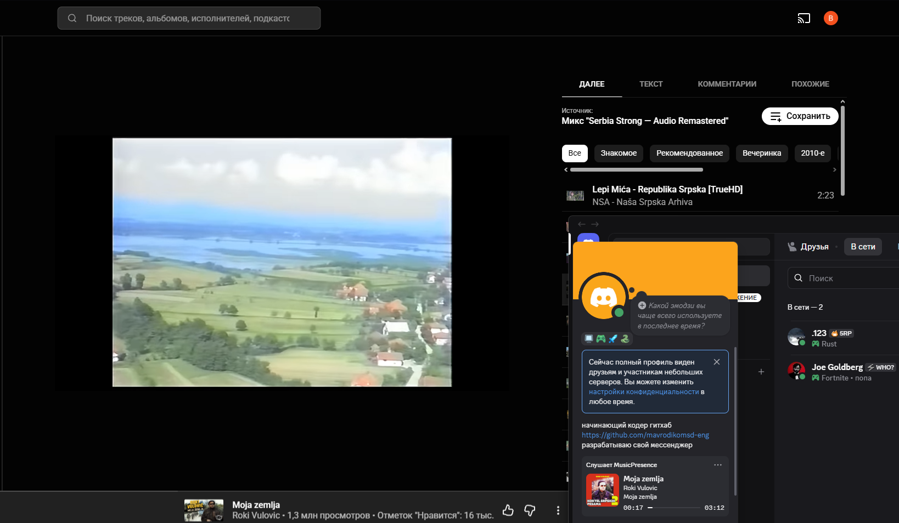

<div align="center">

# 🎵 MusicPresence

**Any Windows player → Discord Rich Presence. YouTube Music in a browser, Spotify, desktop players — everything the system can see.**

Cover art, live timecodes, one `.exe`, zero bloat.

[](https://github.com/mavrodikomsd-eng/discord-music-presence/releases)
[](https://github.com/mavrodikomsd-eng/discord-music-presence/releases)
[](https://github.com/mavrodikomsd-eng/discord-music-presence)

[English](#-english) · [Русский](#-русский)



</div>

---

## 🇬🇧 English

### What it does

MusicPresence reads what your system is playing (via **Windows SMTC**) and shows it as your **Discord Rich Presence**: track title, artist, album, **live ticking timecodes** and **cover art** (fetched from iTunes Search). Works with YouTube Music in a browser, Spotify, desktop players — anything that publishes to SMTC.

### ✨ Features

- 🎧 Title, artist, album and cover art in your Discord status
- ⏱️ Live progress bar with timecodes (both in Discord and in the app window)
- ⏸️ Pause handling, clean status on stop/exit
- 🖼️ Big cover, dark/light theme, session history — in the app
- 🚀 **Autostart with Windows** — one checkbox
- 💾 Cover cache, so iTunes is not hammered on every track
- 🔍 `--dump` diagnostic mode: see exactly what SMTC reports
- 🔒 Privacy: only reads what players publish to the system. No browser data, no tokens.

### 🚀 Quick start (no build tools needed)

1. **Download** `MusicPresence.exe` from [Releases](https://github.com/mavrodikomsd-eng/discord-music-presence/releases) and run it.
2. Get your **Client ID**: [discord.com/developers/applications](https://discord.com/developers/applications) → *New Application* → copy the **Application ID** → paste it in the app → *Save*. One minute, no bot creation needed. (Why your own ID: the activity shows as *your* application — a shared ID looks like spam and risks a ban.)
3. Play music. Your Discord status comes alive.

<details>
<summary><b>Build from source</b></summary>

```powershell
git clone https://github.com/mavrodikomsd-eng/discord-music-presence.git
cd discord-music-presence
cargo build --release
target\release\musicpresence.exe
```

Requires Rust stable (Windows 10 1803+ for SMTC).

</details>

### ❓ FAQ

<details>
<summary>Cover art doesn't show up</summary>
The cover comes from an iTunes Search lookup by title+artist. Rare/misspelled tracks may miss; the status then shows without a picture. Everything else keeps working.
</details>
<details>
<summary>My player isn't detected</summary>
The player must publish to Windows SMTC (most modern players and browsers do). Run <code>musicpresence.exe --dump</code> to see what the system reports.
</details>
<details>
<summary>Is it safe?</summary>
Yes — SMTC is the official Windows media API. MusicPresence only reads the metadata players publish themselves and talks to Discord via local IPC. No tokens, no browser history, no network calls except the iTunes cover lookup.
</details>

---

## 🇷🇺 Русский

### Что это

MusicPresence читает то, что играет в системе (через **Windows SMTC**), и показывает это как **Discord Rich Presence**: название, исполнитель, альбом, **живые таймкоды** и **обложка** (ищется через iTunes Search). Работает с YouTube Music в браузере, Spotify, десктопными плеерами — со всем, что публикует SMTC.

### ✨ Возможности

- 🎧 Название, исполнитель, альбом и обложка в статусе Discord
- ⏱️ Живой прогресс-бар с таймкодами (и в Discord, и в окне программы)
- ⏸️ Корректная пауза, чистый статус при стопе и выходе
- 🖼️ Крупная обложка, тёмная/светлая тема, история сессии
- 🚀 **Автозапуск вместе с Windows** — одна галочка
- 💾 Кэш обложек — iTunes не дёргается на каждый трек
- 🔍 Режим диагностики `--dump`
- 🔒 Приватность: читается только то, что плееры сами публикуют в системе. Никаких данных браузера, никаких токенов.

### 🚀 Быстрый старт

1. **Скачай** `MusicPresence.exe` из [Releases](https://github.com/mavrodikomsd-eng/discord-music-presence/releases) и запусти.
2. Получи **Client ID**: [discord.com/developers/applications](https://discord.com/developers/applications) → *New Application* → скопируй **Application ID** → вставь в программе → *Save*. Одна минута, бота создавать не нужно.
3. Включи музыку — статус в Discord оживает.

### 🔧 Как это работает

```
[плеер / браузер] ──► Windows SMTC ──► MusicPresence ──► Discord Rich Presence
              (системный API)      │
                                   └──► iTunes Search API (только URL обложки)
```

| Модуль | Роль |
|---|---|
| `src/smtc_source.rs` | слой WinRT: SMTC → `TrackSnapshot` + байты обложки |
| `src/timeline.rs` | математика живых таймкодов (протестирована) |
| `src/artwork.rs` | iTunes-поиск обложки, кэш |
| `src/discord_presence.rs` | Discord IPC, бэкофф, сборка activity payload |
| `src/autostart.rs` | автозапуск с Windows (HKCU Run) |

---

<div align="center">

**Понравилось — поставь ⭐. Баг нашёл — открой [issue](https://github.com/mavrodikomsd-eng/discord-music-presence/issues).**

</div>
