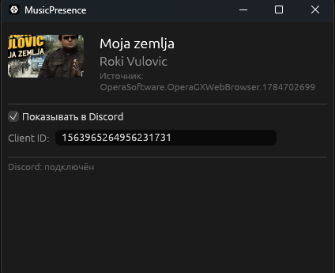

# 🎵 MusicPresence

Показывает музыку, которую вы слушаете (в том числе **YouTube Music в браузере**), как Discord Rich Presence — с обложкой и бегущими таймкодами. GUI на egui, один `.exe`-файл.

> ✅ Статус: MVP готов, работает под Windows 10/11.

---

## 🖼️ Скриншоты

### 💻 GUI программы



### 💬 Статус в Discord


---

## 🧩 Как это работает

```
[плеер / браузер] ──► Windows SMTC ──► MusicPresence ──► Discord Rich Presence
              (системный API)      │
                                   └──► iTunes Search API (только URL обложки)
```

| Компонент | Что делает |
|---|---|
| **Windows SMTC** | Система сама собирает метаданные с плееров и браузеров (YouTube Music, Spotify, десктопные плееры и т.д.) |
| **MusicPresence** | Читает SMTC, считает таймкоды, запрашивает обложку через iTunes, отправляет в Discord |
| **Discord** | Показывает статус «Listening to …» с картинкой и прогресс-баром |

**Важно:** приватные данные браузера не читаются, токены не крадутся. Только то, что плеер сам опубликовал в системе.

---

## 🚀 Быстрый старт

### 1. Соберите или скачайте

Нужен Rust (stable, Windows):

```powershell
cargo build --release
target\release\musicpresence.exe
```

### 2. Настройте Discord Client ID

1. Откройте [Discord Developer Portal](https://discord.com/developers/applications).
2. Нажмите **New Application**, придумайте название.
3. Перейдите во вкладку **General Information** и скопируйте **Application ID** — это длинное число.
4. В окне MusicPresence вставьте его в поле **Client ID** и нажмите **Save**.
   > ID сохраняется в `%APPDATA%\MusicPresence\config.json`.

> ℹ️ Бота создавать не нужно. Client ID публичный, его можно показывать.  
> **Почему нужен свой, а не общий:** Discord привязывает активность к приложению. Если все будут использовать один ID, это будет выглядеть как спам, и приложение могут забанить. Свой ID — одна минута регистрации, и ваш статус будет под своим приложением.

### 3. Запустите музыку

Включите трек в Opera GX / YouTube Music или другом плее
ре. В Discord у вас должен появиться статус с обложкой и таймкодами.

---

## 🔍 Режим диагностики (`--dump`)

Посмотреть, что «видит» программа из SMTC, без GUI и Discord:

```powershell
cargo run -- --dump
```

Пример вывода:

```json
{
  "title": "Serbia Strong — Audio Remastered",
  "artist": "Alexey Grushnik LIVE",
  "album": null,
  "duration_secs": 218,
  "position_secs": 177,
  "status": "Playing",
  "source_app": "OperaSoftware.OperaGXWebBrowser.1784702699"
}
```

---

## ✨ Что уже умеет MVP

- 🎧 Название, исполнитель, альбом и обложка в статусе Discord
- ⏱️ Прогресс трека: тикающий таймер и полоса времени (start/end timestamps)
- ⏸️ Пауза → «⏸ Пауза»; стоп → статус очищается; закрытие окна → очистка
- 🔄 Выбор источника: приоритет сессии в состоянии `Playing`
- ⏭️ Обнаружение перемотки: пересчёт таймкодов при скачке позиции
- 💾 Кэш обложек (по треку), чтобы не дёргать iTunes повторно

---

## ⚠️ Известные ограничения

- Windows 10 1803+ (SMTC); источники, не публикующие SMTC, не видны.
- Обложка зависит от точности iTunes-поиска; при промахе статус остаётся без картинки.
- Несколько одновременных сессий (браузер + Spotify) — берётся первая `Playing`.
- Client ID у каждого свой.

---

## 📁 Структура кода

| Модуль | Роль |
|---|---|
| `src/smtc_source.rs` | единственный слой WinRT: SMTC → `TrackSnapshot` + байты обложки |
| `src/track.rs` | доменные типы и сравнение треков |
| `src/timeline.rs` | математика позиций/таймкодов (протестирована) |
| `src/artwork.rs` | iTunes-поиск обложки, кэш |
| `src/discord_presence.rs` | Discord IPC, бэкофф, сборка activity payload |
| `src/poller.rs` | поток-поллер: SMTC → решение → Discord → общее состояние |
| `src/app.rs` | egui-интерфейс |
| `src/config.rs` | сохранение Client ID |

Тесты: `cargo test` (юнит-тесты; живой iTunes-тест: `cargo test live -- --ignored`).

---

## 🛠️ Стек технологий

- **Rust** — язык реализации
- **eframe / egui** — GUI
- **windows-rs 0.62** — доступ к WinRT / SMTC
- **discord-rich-presence 1.1.0** — Discord IPC
- **ureq** + **iTunes Search API** — обложки (бесплатно, без ключа)
- **pollster** — блокирующие вызовы WinRT без tokio

---

## 🤖 Создано с помощью ИИ

Приложение разработано с использованием **ИИ** и инструмента **opencode** (кодинг-агент) при написании кода, отладке бага временной шкалы и оформлении документации.

---

## 📄 Лицензия

MIT
